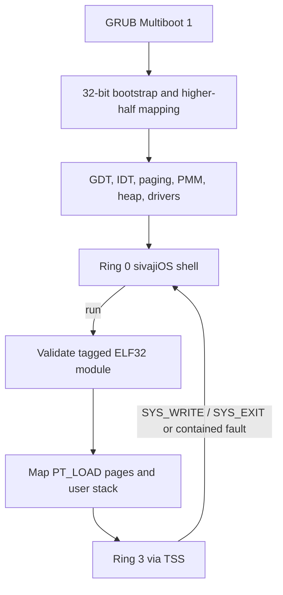

# sivajiOS

**Created by Saransh Sapra** — a small educational operating system built
from scratch for x86 32-bit BIOS systems.

sivajiOS combines a GRUB Multiboot 1 BIOS kernel, framebuffer terminal,
keyboard input, protected memory, a kernel heap, Ring 3 execution, system calls,
and a static ELF32 loader. A separate x86-64 UEFI target remains available.
The BIOS kernel is C and NASM, built with GNU Make and GCC/binutils.

## Boot and architecture

GRUB loads `kernel.elf` and passes Multiboot information to the BIOS entry.
The assembly bootstrap enables paging, maps the kernel at its higher-half
virtual address, installs the GDT, and enters C. The kernel then configures the
IDT, paging, framebuffer, PMM, heap, PIC, and keyboard IRQ before the default
shell starts. The shell stays in Ring 0 and consumes translated keyboard events
outside interrupt context.



The BIOS kernel has a GDT with kernel and user segments and a 32-bit TSS with a
dedicated Ring 0 stack. The IDT handles CPU exceptions and PIC IRQs; its only
user-callable gate is `int 0x80`. Paging keeps kernel mappings supervisor-only
and marks user PDEs and PTEs for Ring 3 access. The PMM tracks reserved and
allocated 4 KiB frames from the Multiboot memory map. The lazy kernel heap
grows within a fixed 16 MiB virtual range and exposes read-only statistics.

The framebuffer driver renders terminal text, while the keyboard IRQ translates
Set 1 scancodes, tracks Shift and Caps Lock, and enqueues bounded events. The
main shell loop handles characters, Enter, and Backspace. The PIC routes IRQ1.
Serial output is available on COM1.

### User mode and ELF32

The fixed user context runs static ELF32 i386 `ET_EXEC` images. The validator
checks headers, segment ranges, permissions, overlap, stack bounds, and page
limits before allocation. `PT_LOAD` data is copied into PMM-backed pages and
BSS is zeroed. The user stack is separately mapped. The syscall ABI uses
`EAX=number`, `EBX`/`ECX`/`EDX` arguments, and `EAX` result: `SYS_WRITE` validates
user buffers and writes to framebuffer and COM1; `SYS_EXIT` returns to the
suspended kernel caller. User faults are contained and loader-owned pages are
released on return.

The default user program verifies its Ring 3 code selector, syscall write
results, writable initialized data, zeroed BSS, and a computation before it
exits. GRUB tags it `shell-main`. The separate `shell-fault` module deliberately
faults and is only run with `run fault`; it is not executed by default.

## Shell commands

- `help` — list commands.
- `clear` — clear the framebuffer terminal.
- `echo <text>` — print text.
- `about` — show project identity and implementation details.
- `meminfo` — distinguish tracked address space, usable RAM, and free physical memory.
- `features` — summarize implemented kernel capabilities.
- `version` — print the centralized project version.
- `run` — launch the explicitly tagged default ELF32 module.
- `run fault` — launch the separate page-fault cleanup fixture.

The command line accepts up to 127 characters; longer lines are rejected on
Enter. Empty lines are ignored. The keyboard driver supports Shift and Caps
Lock; the small framebuffer font does not include every possible glyph.

`meminfo` separates the PMM bitmap's tracked physical address range from RAM
reported usable by the Multiboot map and from currently free frames. Reserved
or unavailable frames include address ranges that are not RAM; they are not
reported as memory consumed by the kernel. The command does not report heap
statistics.

## Build and run

Build the BIOS ISO with:

```sh
make -j2
```

Run the BIOS image in QEMU with `make run`, or launch explicitly:

```sh
qemu-system-i386 -cdrom os.iso -boot order=d -m 32
```

The BIOS GRUB menu has one default entry, `sivajiOS`, which loads the kernel,
`user.elf shell-main`, and `user-fault.elf shell-fault` in that order. This
keeps fault fixtures available without selecting them as the default program.
The diagnostics remain in the kernel and can be selected by editing the GRUB
kernel command line (for example `pmm-test`, `heap-test`, `ring3-test`,
`ring3-fault-test`, `syscall-test`, `elf-test`, `elf-fault-test`, or
`paging-fault-test`). The flat-binary module code remains in the source and its
GRUB module is still packaged as `modules/program`.

Run the host-side ELF validator checks with:

```sh
make test-elf-validator
```

Build the independent x86-64 UEFI target with `make uefi`. `make run-uefi`
launches it with OVMF when firmware files are installed. The UEFI image does
not depend on the BIOS shell, ELF loader, keyboard queue, or 32-bit memory
managers.

## Current scope

sivajiOS is a single-context educational OS. It has no scheduler, filesystem,
disk driver, networking, multitasking, multiple simultaneous processes,
dynamic linking, or GUI. User addresses, page-table storage, and the ELF user
stack are fixed; there is no general process or executable service. The kernel
heap is single-threaded and retains mapped heap pages after free.
